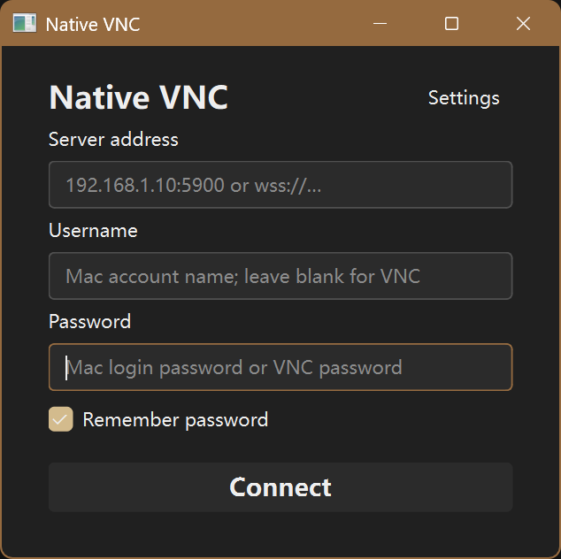

# NativeVNC

[English](#english) · [简体中文](#简体中文)

## English

A **minimal VNC client for Windows**, built with Python and PySide6. Once connected, the remote screen fills the client area with no in-app buttons or toolbars. The window uses the native Windows title bar, borders, and minimize, maximize/restore, and close controls. Press **F11** for full screen.

NativeVNC is a standalone native desktop application with no browser or WebView dependency. It started in a [noVNC](https://github.com/novnc/noVNC) source directory and is now maintained as a separate repository. It is not an official noVNC client and does not load the noVNC web frontend at runtime. See [NOTICE.md](NOTICE.md) for provenance, attribution, and licensing.

### Screenshot

**Login**

<p align="center">
  
</p>

### Run from source

Requires Python 3.10 or newer. Run these commands from the project root:

```powershell
python -m venv .venv
.\.venv\Scripts\python.exe -m pip install -r requirements.txt
.\.venv\Scripts\python.exe -m native_vnc
```

You can also use `run_native.py` or `run-native.ps1`. These launchers run the source code without packaging it.

For VS Code, open the project root, select `.venv\Scripts\python.exe`, press F5, and choose **Native VNC**. The launch configuration runs the `native_vnc` module. For the editor's **Run Python File** command, open `run_native.py`; running `native_vnc/__main__.py` directly fails because it uses package-relative imports.

### Connect and control

- **Mac Screen Sharing:** enter the server address, the Mac account's short name, and its login password. The username is not an Apple ID or display name. The account needs Screen Sharing control permission.
- **Standard VNC:** leave the username blank and enter the VNC password. Leave the password blank for a server configured without authentication.
- Accepted addresses include `192.168.1.10:5900`, `[::1]:5900`, `vnc://host:5900`, `ws://host:6080/websockify`, and `wss://host/path?token=...`. Use an actual VNC or WebSocket endpoint, not a noVNC HTTP page URL.
- The compact, neutral interface follows the system's light or dark theme. Windows provides the title bar, borders, and standard window controls. English is the default; **Settings** switches between English and Simplified Chinese, including connection and error messages.
- The login window opens centered with a 360 × 330 client area. Its size, position, and maximized state are not remembered. Status messages appear below the form and expand the window when needed.
- The remote window remembers its position, size, maximized state, and F11 full-screen state. After connecting, its normal size is adjusted to the remote aspect ratio and available screen area. Disable **Remember last window size** to use the default width instead; maximized and full-screen states are still remembered.
- Drag the standard window borders to resize, drag the title bar to move, or double-click it to maximize or restore. The remote image scales proportionally without changing the remote resolution. Clicks in letterboxed areas are ignored.
- Mouse input supports remote cursor shapes, left/right/middle buttons, dragging, and horizontal/vertical scrolling. Keyboard and mouse input are sent independently of frame reception; redundant pointer moves and obsolete pending frames are coalesced to reduce delay.
- **Mac scroll speed:** some macOS Screen Sharing versions interpret standard VNC wheel events as tiny movements ([upstream report](https://github.com/TigerVNC/tigervnc/issues/1741)). NativeVNC compensates for detected Mac connections with a default 50× wheel multiplier. Adjust **Settings → Mac scroll speed** from 1× to 100×; lower it if apps such as Terminal scroll too fast. Standard VNC connections keep their original speed. Scroll events are batched, with a limit of 500 steps per axis per wheel event to avoid excessive bursts.
- **Reverse scroll direction** in Settings is off by default. Enable it to reverse both horizontal and vertical scrolling for all connections; the choice is saved.
- The connected view fills the client area with no in-app buttons, toolbars, or extra margins. Window controls use native Windows components. F11 toggles full screen and hides the system title bar; other ordinary keystrokes go to the remote computer. Losing focus releases held remote keys and mouse buttons.
- A dropped connection retains the last frame and offers **Reconnect**. Close the window to end the session and exit.

### Settings and passwords

Settings are stored in `%APPDATA%\NativeVNC\settings.json`. The last address and username are saved automatically. With **Remember password** enabled, the password is saved only after successful authentication and encrypted using the current Windows user's DPAPI. Editing the address or username clears the password field; switching identities clears the previous identity's saved password. Uncheck **Remember password** and connect or exit to remove the saved password.

WebSocket URLs, including any tokens they contain, are stored as addresses in the local settings file.

### Supported scope

- RFB 3.3 / 3.7 / 3.8, Apple DH authentication (security type 30), traditional VNC password authentication, and no authentication.
- Mac Screen Sharing's 3.888 / 3.889 version banners and shared-control mode. Initial keyboard events are briefly queued because Mac servers may ignore them during roughly the first two seconds of a session.
- Raw, CopyRect, Hextile, and Zlib encodings; Cursor, DesktopSize, and LastRect extensions. CopyRect copies scrolling regions inside the framebuffer, and a low compression level is requested from servers that support it.
- WSS uses normal certificate validation. Plain TCP VNC and WS do not encrypt traffic.
- Web login cookies, enterprise authentication, VeNCrypt, file transfer, clipboard synchronization, multiple sessions, and a system tray are outside this version's scope.
- Windows may handle system-reserved shortcuts locally. There is no button for sending Ctrl+Alt+Del. Input-method text uses Unicode keysyms; support depends on the server.

With a username supplied, Mac authentication uses the account password through Apple DH and does not fall back to a separate VNC sharing password. With a blank username, standard VNC password authentication is used. Successful account authentication does not guarantee bypassing the Mac lock screen, FileVault, or session selection. The client does not type login passwords or change remote locking settings.

### Build a Windows executable

Run `build.bat` yourself from the project root. It creates or reuses `.venv`, installs dependencies, and builds a single executable, keeping the console open to show the result. Alternatively, run:

```powershell
.\.venv\Scripts\python.exe -m pip install -r requirements.txt pyinstaller
.\.venv\Scripts\python.exe -m PyInstaller --noconfirm --clean NativeVNC.spec
```

The output is `dist\NativeVNC.exe`; copy that single file to another computer. Single-file mode extracts dependencies at startup. If you change the spec to a directory-based distribution, ship the entire output directory and its dependencies. The packaging entry point is `run_native.py`, not `native_vnc/__main__.py`. User settings remain in `%APPDATA%\NativeVNC\settings.json` and are not bundled.

### Project layout and license

```text
NativeVNC/
├── native_vnc/            # Native client source
├── docs/screenshots/      # README screenshots
├── .vscode/launch.json    # Module-based debugging
├── licenses/noVNC/        # Upstream attribution and license notices
├── requirements.txt      # Runtime dependencies
├── run_native.py          # Script entry point
├── run-native.ps1         # PowerShell launcher
├── build.bat              # Build script for the user to run
├── NativeVNC.spec         # PyInstaller single-file configuration
├── LICENSE               # MPL-2.0
└── NOTICE.md             # Provenance and attribution
```

Commit the source, dependencies, build configuration, documentation, and license files. `.gitignore` excludes virtual environments, caches, build outputs, executables, personal settings, common key files, and temporary files. Do not copy old noVNC web assets or your local application settings into this repository.

NativeVNC is licensed under [MPL-2.0](LICENSE) and retains the [noVNC attribution](NOTICE.md). Associate releases with their corresponding source code so users can find the implementation for each version.

## 简体中文

一个使用 Python / PySide6 开发的 **Windows 极简 VNC 客户端**。连接后远程画面填满客户区，没有任何应用内按钮或工具栏；窗口使用 Windows 原生标题栏、边框及最小化、最大化/还原、关闭控件，按 **F11** 切换全屏。客户端独立运行，不依赖浏览器或 WebView。

项目最初基于 [noVNC](https://github.com/novnc/noVNC) 开发，现将原生客户端单独整理为源码仓库；运行时不依赖 noVNC 网页前端。来源、署名和许可证说明见 [NOTICE.md](NOTICE.md)。本项目不是 noVNC 官方客户端。

### 截图

**登录界面**

<p align="center">
  
</p>

### 启动

在项目根目录执行：

```powershell
python -m venv .venv
.\.venv\Scripts\python.exe -m pip install -r requirements.txt
.\.venv\Scripts\python.exe -m native_vnc
```

需要 Python 3.10 或更高版本。也可运行根目录的 `run_native.py` 或 `run-native.ps1`。启动脚本只运行源代码，不执行打包。

#### VS Code 运行和调试

用 VS Code 打开项目根目录 `NativeVNC`，选择 `.venv\Scripts\python.exe` 解释器，然后按 F5，选择 `Native VNC`。项目的 `.vscode/launch.json` 使用模块方式启动，相当于 `python -m native_vnc`。

使用编辑器右上角的“运行 Python 文件”时，请打开根目录的 `run_native.py` 再运行。不要直接运行 `native_vnc/__main__.py`：它使用包内相对导入，作为独立文件运行会出现 `attempted relative import with no known parent package`。

### 打包 Windows 程序

双击项目根目录的 `build.bat` 即可。脚本自动创建或复用 `.venv`、安装依赖并打包成单个可执行文件，成功或失败后都会保留窗口显示结果。此脚本由用户自行运行。

以下命令由用户在项目根目录的 PowerShell 中自行执行。建议使用独立虚拟环境，避免把其他项目的依赖一起收集：

```powershell
.\.venv\Scripts\python.exe -m pip install -r requirements.txt pyinstaller
.\.venv\Scripts\python.exe -m PyInstaller --noconfirm --clean NativeVNC.spec
```

输出为 `dist\NativeVNC.exe`，发送到其他电脑时复制这一个文件即可。

当前 `NativeVNC.spec` 使用单文件模式，启动时需要解压依赖。若以后调整为目录分发，需要修改打包配置，并复制整个输出目录及其依赖；仅复制目录版 exe 会缺少 Python DLL。

`run_native.py` 是打包入口；不要直接把包含包内相对导入的 `native_vnc\__main__.py` 当作脚本入口。配置仍保存在当前用户的 `%APPDATA%\NativeVNC\settings.json`，不包含在分发文件中。

### 交互

- Mac 自带屏幕共享：填写地址、Mac 账户短名称和账户登录密码，按回车连接。用户名不是 Apple ID，也不是账户显示名称。
- 普通 VNC：将用户名留空，填写 VNC 密码；免密连接可将密码留空。
- 地址支持 `192.168.1.10:5900`、`[::1]:5900`、`vnc://host:5900`、`ws://host:6080/websockify`、`wss://host/path?token=...`。
- 地址需要是实际 VNC 或 WebSocket 入口，不能直接填写 noVNC 的 HTTP 网页链接。
- 界面采用灰色简洁样式，保留微软雅黑和原有字号，深浅色跟随系统实时切换；标题栏、最小化、最大化/还原、关闭及窗口边框由 Windows 提供。
- 默认使用英语。点击登录页标题右侧的 Settings / 设置，可切换 English / 简体中文，保存后立即生效并记住选择；连接状态、验证错误和断线提示也随语言切换。
- 设置中的“记忆上次窗口大小”默认开启。关闭后不保存普通窗口的尺寸和位置，下次使用默认宽度并按远端屏幕比例调整；最大化和全屏状态仍按原有规则记忆。
- 登录页以 360 × 330 的客户区居中打开，不记忆登录页的位置、大小或最大化状态。表单靠上排列，连接状态和错误显示在按钮下方；较长信息自动增加高度，不移动或压缩输入框。
- 断开或退出时记忆共享屏幕窗口的位置、尺寸、Windows 最大化和 F11 全屏状态，点击关闭时立即保存。登录页仍以普通窗口打开，连接成功后恢复上次最大化或全屏状态；普通窗口收到首帧后，以记忆的窗口宽度为起点，重新按远端画面比例调整客户区，避免旧尺寸产生空白边，并计入 Windows 标题栏和边框，适应当前显示器的可用区域。远端分辨率变化或退出全屏回到普通窗口时也会重新调整。
- 拖动 Windows 标准窗口边缘或四角调整大小；拖动系统标题栏移动窗口，双击标题栏最大化或还原。画面等比适应，不改变远端分辨率。黑边不向远端发送点击。
- 鼠标使用本地系统光标，支持远端光标形状、左右键、中键、拖拽和横纵滚轮。未收到远端光标时使用系统箭头。
- **Mac 滚轮速度**：部分 macOS 屏幕共享版本会把标准 VNC 滚轮事件解释为很小的位移（[上游问题记录](https://github.com/TigerVNC/tigervnc/issues/1741)）。客户端仅对识别出的 Mac 连接默认使用 50× 滚轮补偿，可在“设置 → Mac 滚轮速度”中调整为 1×–100×；若终端等应用滚动过快，可调低倍率。普通 VNC 连接保持原始速度。滚轮事件批量发送，每次输入的每个轴最多发送 500 步，避免过量突发输入。
- 设置中的“反转滚轮方向”默认关闭。开启后反转所有连接的横向和纵向滚动，并记住选择。
- 键鼠输入独立发送，不等待图像接收超时；鼠标移动按需合并，空闲时不启动移动定时器。界面忙时直接显示最新完整画面，避免旧帧排队积累延迟。优先使用 CopyRect 在画面缓冲区内复制滚动区域，减少临时内存分配，并向支持的服务端请求低压缩等级，以减少编码开销。
- 连接成功后没有任何应用内按钮或工具栏，远程画面填满客户区，四周没有额外留白；窗口控件使用 Windows 原生组件。F11 切换全屏，全屏时隐藏系统标题栏。其他常规键盘输入发给远端。
- 失去焦点时释放远端按键和鼠标按钮。断线保留最后画面，点击“重新连接”重试；使用系统关闭按钮结束连接并退出。
- 自动保存上次地址、用户名。勾选“记住密码”后，仅在成功认证后保存密码。编辑地址或用户名时清空密码输入，切换身份后清除旧身份保存的密码。

配置位于 `%APPDATA%\NativeVNC\settings.json`，语言和窗口记忆选项也保存在此处；密码使用当前 Windows 用户的 DPAPI 加密。取消“记住密码”并连接或退出即可清除保存的密码。带令牌的 WebSocket 地址会作为地址保存到本机配置文件。

### 第一版范围

- RFB 3.3 / 3.7 / 3.8；Mac 账户认证（Apple DH / security type 30）、免密和传统 VNC 密码认证。
- 识别 Mac 自带屏幕共享的 3.888 / 3.889 协议版本，连接后请求共享控制模式。Mac 建立会话后的约两秒内可能忽略按键，客户端会暂存最初的键盘事件后按顺序发送。
- Raw、CopyRect、Hextile、Zlib 图像编码；Cursor、DesktopSize、LastRect 扩展。
- WSS 使用正常证书校验，不跳过无效证书。TCP VNC 和 WS 本身不加密。
- 网页登录 Cookie、企业认证、VeNCrypt、文件传输、剪贴板同步、多会话、托盘不包含在此版本中。
- 系统保留组合键仍可能由本机 Windows 处理；当前界面不提供向远端发送 Ctrl+Alt+Del 的按钮。
- 中文输入法提交的文字通过 Unicode keysym 发送，实际支持取决于 VNC 服务端。

#### Mac 锁屏

填写用户名时，通过 Apple DH 使用 Mac 账户密码认证，不降级为单独的 VNC 共享密码。该账户必须具有屏幕共享控制权限。用户名留空时仍使用传统 VNC 共享密码。

账户认证与屏幕解锁由 Mac 分别决定；账户认证成功不保证跳过所有锁屏、FileVault 或会话选择。客户端不模拟输入登录密码，也不修改远端锁屏设置。

### 项目结构

```text
NativeVNC/
├── native_vnc/            # 原生客户端源码
├── docs/screenshots/      # README 截图
├── .vscode/launch.json    # VS Code 模块启动配置
├── licenses/noVNC/       # 上游原始署名和许可证说明
├── requirements.txt      # 运行依赖
├── run_native.py          # 脚本入口
├── run-native.ps1         # PowerShell 启动脚本
├── build.bat              # 用户自行执行的打包脚本
├── NativeVNC.spec         # PyInstaller 单文件配置
├── LICENSE                # MPL-2.0 全文
└── NOTICE.md              # 来源与署名
```

### 上传源码

将整个项目作为独立 Git 仓库管理。`.gitignore` 已排除虚拟环境、缓存、构建目录、可执行文件、个人设置、常见密钥及临时文件。提交源码、依赖说明、构建配置及许可证文件即可；不要把旧 noVNC 仓库的网页资源或本机的 `%APPDATA%\NativeVNC` 配置复制进来。

本项目沿用 MPL-2.0，见 [LICENSE](LICENSE)，并保留 [noVNC 来源说明](NOTICE.md)。后续发布版本时，将对应源码与发布版本关联，方便使用者找到对应实现。
